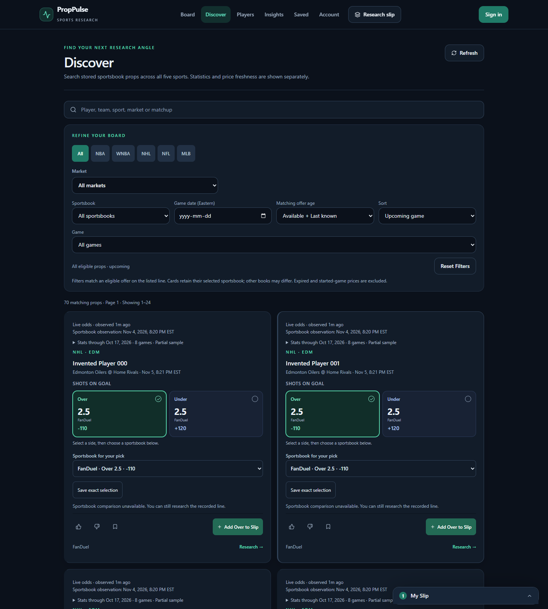
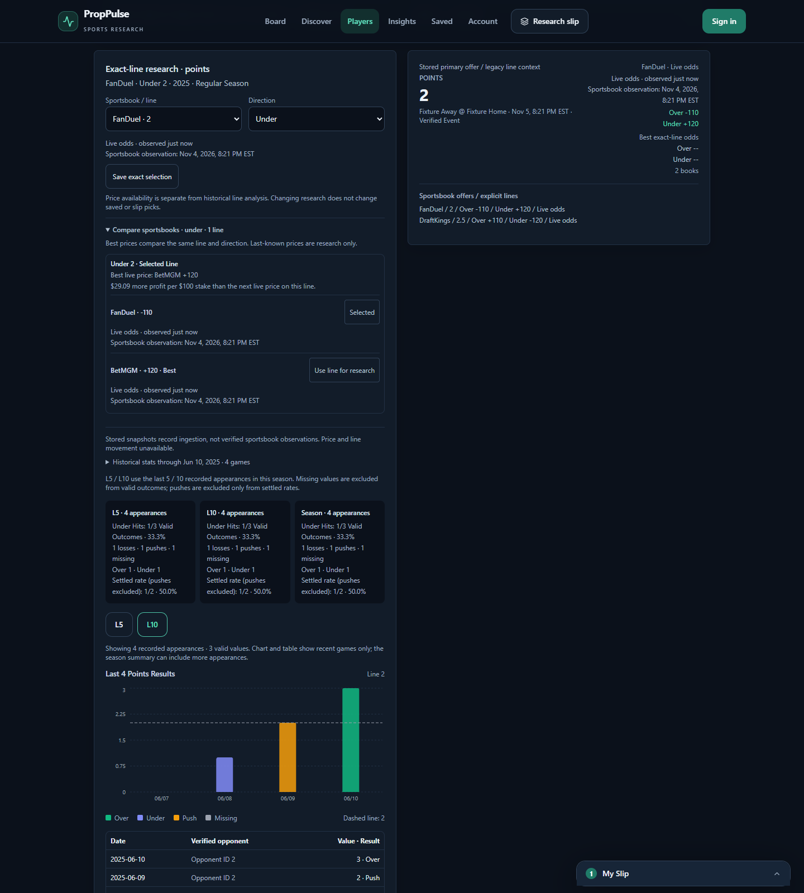
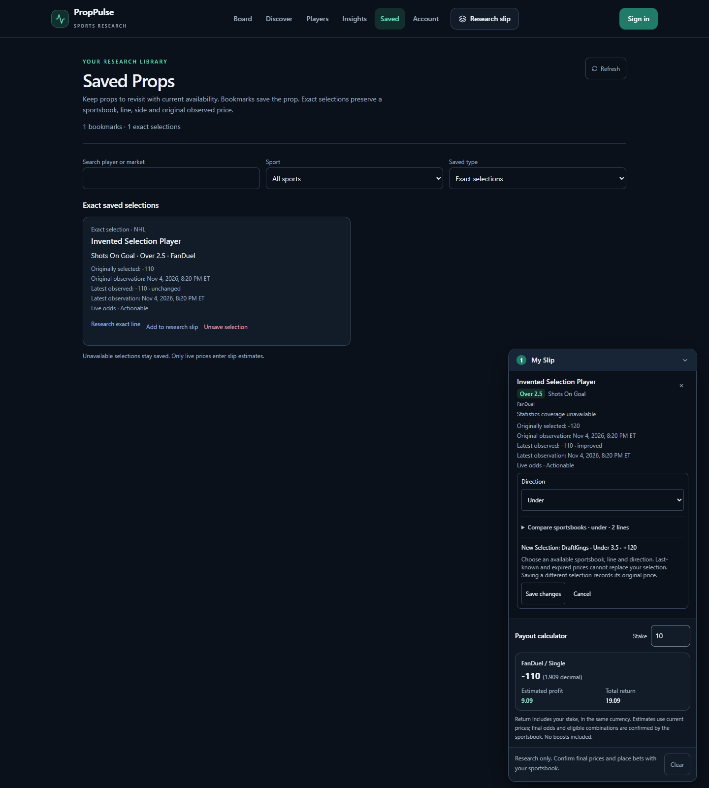
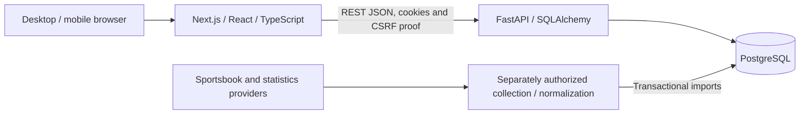

# PropPulse

**A full-stack research workspace for comparing player statistics with exact sportsbook lines.**

PropPulse brings multi-sport game logs, sportsbook comparisons and saved research into one workflow. Users can inspect a player's recorded performance, compare equivalent offers, and build an editable research slip without losing their choices when prices expire.

**Next.js · React · TypeScript · Python · FastAPI · PostgreSQL · SQLAlchemy / Alembic · Docker**

Built as a software engineering portfolio project, with particular attention to data correctness, API integration and secure account persistence. It does not place bets or provide validated win probabilities. **Public deployment is not approved; no hosted demo is currently advertised.**

[Screenshots](#screenshots) · [Features](#features) · [Architecture](#architecture) · [Engineering decisions](#engineering-decisions) · [Local setup](#local-setup-windows-powershell) · [Testing and security](#testing-and-security)

## Screenshots

Actual browser captures of the running application using **invented offline fixtures**, including prices and account state. “Live odds” is a simulated UI state here, not a claim of current market data. No provider requests or application database records were used. Click an image for full resolution.

**Discover dashboard** — search, sport and sportsbook filters, pagination, and player-prop cards with separate price/statistics freshness.

[](docs/images/discover-dashboard.png)

<details>
<summary>Exact-line research and sportsbook comparison</summary>

Compare two sportsbooks at the same line, inspect L5/L10 sample denominators, and see recorded outcomes against the line on a chart. All values are synthetic.

[](docs/images/exact-line-research.png)

</details>

<details>
<summary>Saved selections and research-slip editing</summary>

An exact saved choice retains its original price while the slip editor previews a different sportsbook, side and line before saving. Account and saved state are browser fixtures, not a real account or proof of database persistence.

[](docs/images/saved-selections-slip.png)

</details>

## Features

- **Multi-sport research:** NBA, WNBA, NFL, NHL and MLB player statistics, recorded game logs, season selection and L5/L10 summaries. Coverage varies by sport and source.
- **Exact-line analysis:** compare recorded results against a selected line and side, with explicit hits, misses, pushes and valid sample sizes.
- **Sportsbook comparisons:** compare prices for the same player, market, event and line; display alternative lines separately.
- **Discover:** server-side search, filters, sorting and pagination with shareable URL state.
- **Saved research:** save bookmarks or exact sportsbook/line/side selections, edit research slips, and restore account state across sessions.
- **Honest availability:** show source coverage, expired prices and missing data; preserve saved choices when their offers become unavailable. Desktop and mobile layouts support the same workflow.

For a walkthrough, see the [3-5 minute demo script and offline replay](docs/portfolio-demo.md). The replay uses clearly labeled **invented fixtures**, not live odds. A new checkout contains no private provider dataset or user accounts; it starts with empty research data.

## Architecture



The frontend calls a REST API for public research and authenticated account operations. PostgreSQL stores players, events, game logs, offer observations, users and saved selections. Alembic manages schema changes. Provider collection is a separate workflow; ordinary research requests do not call sports providers.

The UI uses Tailwind CSS, Recharts and Zustand. Backend imports normalize source identities and sport-specific metrics before persistence. The backend runtime uses a non-root, multistage Docker image. Redis is configured locally but is not used for application caching. See [architecture and data contracts](docs/architecture.md) for details.

## Engineering decisions

1. **Compare equivalent offers.** Player, market, event, exact line and side define a price comparison. Pushes and missing statistics have explicit treatment in research denominators, preventing misleading comparisons across lines or incomplete samples.
2. **Keep identity and freshness intact.** Provider mappings and event checks reject ambiguous matches. Transactional, repeatable imports protect retained data. Availability uses provider observation time; an API response cannot make old odds fresh, and expired offers never silently replace a saved selection.
3. **Enforce account boundaries on the server.** bcrypt password hashes and expiring JWTs in HttpOnly cookies support authentication. CSRF proofs, trusted origins and user-scoped database queries protect mutations and ownership. The frontend sends credentialed requests without persisting authentication JWTs in localStorage.

Scores and workload indices are heuristics. The legacy XGBoost/SHAP experiment is optional and is not a validated prediction system or part of normal setup.

## Local setup (Windows PowerShell)

Use **Node.js 24** (tested with 24.22.1), **Python 3.11** (the Docker runtime), Docker Desktop and Git. Run from the repository root. These instructions are for a **new local checkout**; do not overwrite existing environments or migrate an existing database without a reviewed backup.

```powershell
Copy-Item .env.example backend/.env
Copy-Item .env.example .env
py -3.11 -m venv backend/venv
backend/venv/Scripts/python.exe -m pip install -r backend/requirements.txt
Push-Location frontend
npm ci
Pop-Location
Set-Content frontend/.env.local 'NEXT_PUBLIC_API_URL=http://localhost:8000'
docker compose up -d db redis
```

Generate a private key with `backend/venv/Scripts/python.exe -c "import secrets; print(secrets.token_urlsafe(48))"` and set `JWT_SECRET` in `backend/.env`. Keep provider keys empty and `LIVE_REFRESH_ENABLED=false`. Settings read the backend environment relative to the backend working directory; root `.env` supplies Compose settings. Python requirements use the committed constraints lock; npm uses `package-lock.json`.

For the **new, empty local database only**, initialize the schema:

```powershell
Push-Location backend
.\venv\Scripts\python.exe -m alembic upgrade head
Pop-Location
```

Current migration head is `20261022_05`. Startup does not migrate or seed the database. See [migration instructions](backend/alembic/README.md); provider collection is optional, separately configured work and is not required to start the app.

Start the API and frontend in separate terminals, each from the repository root:

```powershell
# Terminal 1
cd backend
.\venv\Scripts\python.exe -m uvicorn app.main:app --reload --port 8000
# Terminal 2
cd frontend
npm run dev
```

Open the [frontend](http://localhost:3000) and [API documentation](http://localhost:8000/docs). `/health` checks liveness; `/ready` checks database readiness. Stop app terminals with Ctrl+C. `docker compose down` stops local services without deleting volumes. Use the [offline replay](docs/portfolio-demo.md#reproducible-offline-replay-and-reset) to explore populated interaction scenarios without provider calls or private data; do not use legacy seed/refresh tools to populate the research database.

## Testing and security

The repository includes backend unit tests, frontend tests, Playwright desktop/mobile scenarios, ownership and CSRF tests, and disposable PostgreSQL integration/restore checks. Local production-like verification exercised HTTPS cookies, gateway limits, least-privilege database roles and a read-only, non-root container runtime. These checks demonstrate local behavior, not a verified cloud deployment.

From `backend`, run the HTTP-blocking test runner:

```powershell
$env:DATABASE_URL='sqlite:///:memory:'
$env:LIVE_REFRESH_ENABLED='false'
.\venv\Scripts\python.exe tests/run_no_provider_http.py
```

PostgreSQL cases require an isolated `proppulse_test_...` database via `PROPPULSE_TEST_POSTGRES_URL`; they skip when unset. Never test against application data. From `frontend` (browser tests use installed Google Chrome by default):

```powershell
npm test
npx tsc --noEmit
npm run build
npm run test:e2e
npx playwright test --config playwright.mobile.config.cjs
```

Browser fixtures and real database tests cover different boundaries. Built-in process-local rate limits are a backstop; production requires coordinated gateway limits. Immediate server-side token revocation is not implemented; residual dependency/image advisories remain documented. See [authentication/API security](docs/security-stage2-auth-api.md), [container remediation](docs/container-image-remediation.md) and the [local release-verification matrix](docs/security-stage3-production-verification.md). Historical private scan files, backups, approval records and generated captures are excluded; public tests use committed invented fixtures and disposable resources.

## Data limits and deployment status

Sport support does not imply complete or current provider coverage. Recorded L5/L10 summaries describe available appearances; missing records do not prove a player did not play. Odds become unavailable as they age or an event starts, and stored observations do not establish complete historical line movement. No profitability, calibrated model accuracy or live coverage guarantee is claimed.

Detailed sport-specific gaps and identity exclusions are in the [source notes](docs/phase-8-multi-sport.md) and [refresh guide](docs/phase-9-unified-refresh.md). A future deployment needs maintained frontend/backend services, private PostgreSQL, HTTPS, secrets, coordinated abuse limits and operational backups. **No hosting platform is selected and public deployment remains unapproved.** See the [provider-independent deployment guide](docs/milestone-3h-staging-recovery.md#current-deployment-guide) and [public snapshot review](PUBLICATION.md).
