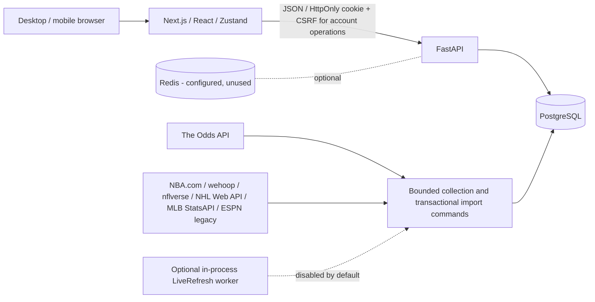

# Architecture and data contracts

This is the current architecture overview. Historical milestone reports retain their original evidence; the Feature 10 update in the deployment report supersedes obsolete runtime/revision guidance.

## Data and normalization

- **Player** is the durable local identity. Provider mappings verify athlete ID, sport and available team/role context; ambiguous identities are excluded rather than merged by name alone. Liam Hicks remains unresolved. Normalized NBA evidence and multi-sport game logs are separate source representations.
- **Event** identifies provider/sport/event with teams and scheduled start. Prop event links are protected against reassignment. **Prop** identifies a player/market/event research subject; its ID survives offer changes.
- **PropBook** holds each current sportsbook line and side prices. **PropBookSnapshot** retains observations. Legacy Prop prices alone are not eligible offers.
- **PlayerGameLog** holds recorded appearances with provider/game identity and sport-specific statistics. **NBAEvidenceRecord** stores append-only normalized NBA source observations used by NBA season research. Missing appearances/stat fields are not synthesized; reviewed competition/season/source filters control denominators.
- **User**, preferences, **Interaction**, **SavedProp**, **Slip** and **SlipItem** retain account state. SavedProp distinguishes generic bookmarks from exact book/line/side choices. Exact selections and slip items retain original odds and observation times; unavailable prices never silently switch selections.

Odds collectors normalize provider market names, athlete identity, event identity, books, lines and American side prices. Request/credit ceilings, quota reserves and dataset locks bound collection. Transaction boundaries and scoped cleanup protect existing valid offers when responses are partial or fail. HTTP 200 does not prove complete market coverage. Unified refresh coordinates existing offline/import paths; it is not a public refresh API or an always-on new scheduler.

Statistics adapters normalize reviewed artifacts with source-specific identity mappings, season and competition, stable game keys, dates and metric conversions (including NHL ice time and MLB innings/outs). Imports are transactional and repeatable; source observation and local ingestion metadata are preserved. Existing legacy MLB rows and conflicting identities stay excluded where required. See [source details](phase-8-multi-sport.md) and [refresh orchestration](phase-9-unified-refresh.md).

## Time, availability and research

Database timestamps follow the existing naive UTC storage convention, serialized consistently as UTC. User-facing game times use Eastern time. Provider observation time establishes what was seen at the source; ingestion time records local persistence; evaluation/response time reports when availability was checked. Neither ingestion nor an API response makes old provider data fresh. Source game date, observed-at and completeness are distinct coverage facts.

Offers are actionable through 30 minutes; last-known through the six-hour TTL is informational, not actionable. Expiry, game start, missing provenance/identity or invalid/null side prices make the offer unavailable. Research feeds exclude synthetic/ineligible offers. Saved/slip pages deliberately retain unavailable user choices. Compare best prices only within equivalent player/market/event/**exact line and side** groups.

Exact-line research computes hits/misses/pushes against the selected line, not a different book's primary line. Pushes are excluded from decided-game percentages; absent metrics are excluded from valid samples. Recorded L5/L10 windows and season summaries expose their own coverage/denominators. NBA season summaries and older line-based ESPN charts may use different sources; one does not certify the other. Scores and payout approximations are experimental, not calibrated probabilities. Historical snapshots do not establish complete sportsbook movement.

## Auth and runtime boundaries

Public research is readable without authentication. Account routes verify an expiring HS256 JWT held in a host-only HttpOnly cookie and resolve the current user server-side; saved rows, selections and open slips are scoped to that user. Passwords remain bcrypt hashes. Unsafe cookie requests require a session-bound CSRF proof and trusted Origin. Logout clears cookies; there is no server-side token revocation or refresh flow. PyJWT replaces python-jose. Production requires Secure cookies, explicit origins and a trusted gateway with coordinated abuse limits; built-in bounded process-local throttles are a backstop. See [Stage 2 configuration and verification](security-stage2-auth-api.md).

Next.js remains a separate production process; the root layout is a server component. Client stores hydrate saved/slip state through the API. Explicit CORS origins and allowed methods, including PATCH, enable account edits across configured origins. Production/staging startup validates configuration and database readiness; it never runs create_all or Alembic.

The optional existing LiveRefresh thread launches ingestion subprocesses only when explicitly enabled, with PostgreSQL scheduling/dataset locks. It is disabled for the portfolio demo. There is no Redis cache, queue, task broker or implemented Redis-based rate limiter. PostgreSQL offers/snapshots provide current retained data. Liveness `/health` is independent of database readiness `/ready`; readiness checks schema revision/prerequisites without repairing them.
